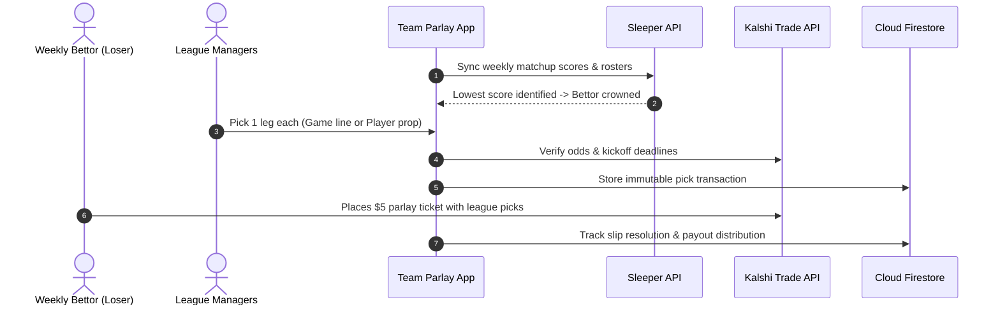
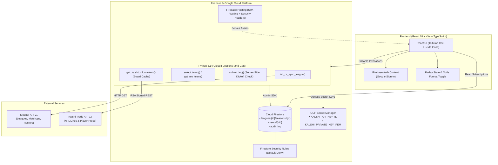

# 🏈 Team Parlay

[](https://react.dev/)
[](https://vitejs.dev/)
[](https://www.typescriptlang.org/)
[](https://tailwindcss.com/)
[](https://www.python.org/)
[](https://firebase.google.com/)
[](https://vitest.dev/)
[](https://pytest.org/)
[](https://opensource.org/licenses/Apache-2.0)

A collaborative fullstack fantasy football application where the lowest-scoring fantasy manager each week funds a \$5 community parlay ticket on Kalshi, built leg-by-leg by the entire league.

---

## Overview

In **Team Parlay**, fantasy football failure turns into collective sweat equity:

1. **Weekly Punishment**: Sleeper league sync ingests matchup scores and crowns the lowest-scoring manager as the week's Bettor.
2. **Collaborative Slip Building**: Every manager in the league chooses exactly one leg from live Kalshi markets (game lines or player props).
3. **The \$5 Community Ticket**: The crowned bettor funds the \$5 parlay ticket placed on Kalshi.
4. **Equal League Payout**: If the slip hits, the jackpot is split equally across all league managers.



---

## Features

- **Automated Sleeper Sync**: Ingests weekly matchups, team rosters, and avatars directly via Sleeper API v1 (`/v1/league/<league_id>/*`).
- **Live Kalshi Market Integration**: Real-time NFL game lines (moneylines, point spreads, game totals) and player props (Anytime TD, Passing/Rushing/Receiving Yards, Completions) pulled via Kalshi Trade API v2.
- **Max Prop Rule**: Enforces an optional maximum probability threshold on player prop contracts to prioritize high-upside legs.
- **Board Caching**: Multi-tiered in-memory and Firestore TTL caching (`kalshi_cache/nfl_board_meta`) reduces external API latency while supporting on-demand manual refresh.
- **Multi-Format Odds Display**: Seamlessly switch between American odds (`+150`, `-110`) and Kalshi probability percentages (`40%`, `52¢`).
- **Real-Time Ticket Tracker**: Displays live parlay progress, earliest kickoff countdown, combo odds, multiplier (`15.2x`), total payout (`$76.00`), and payout per player (`$6.33`).
- **Roster Claim & Security**: Google Authentication with UID-scoped roster claims, mutual confirmation checks, and server-side kickoff validation.
- **Past Slips Archive & Settlement Grading**: Historical ledger tracking full ticket statuses (`WON`, `LOST`, `OPEN`, `LOCKED`, `PUSHED`, `VOIDED`) and individual leg outcomes.
- **Sleeper Chat Export**: One-click markdown generator ready to paste into Sleeper league chats.

> [!NOTE]
> The **Max Prop Rule** is configured via `MAX_LEG_ODDS_PERCENT` in `functions/.env` (e.g. `MAX_LEG_ODDS_PERCENT=50` blocks player props priced above 50¢ / 50%). If left blank or unset, no ceiling is enforced.

> [!IMPORTANT]
> Kickoff deadlines are strictly validated server-side in `submit_leg`. Picks cannot be submitted or modified once an NFL game has started.

---

## Architecture



---

## Repository Structure

```
team_parlay/
├── firebase.json               # Firebase Hosting, Functions, and Emulator config
├── firestore.rules             # Production security rules (default-deny)
│
├── frontend/                   # React 18 + Vite frontend
│   ├── src/
│   │   ├── components/         # BettorBanner, ParlayCard, PickModal, Archive, etc.
│   │   ├── services/           # Firebase SDK & Kalshi client integrations
│   │   ├── utils/              # Odds math & NFL team metadata
│   │   └── tests/              # 16 Vitest test suites (156 tests)
│   ├── package.json
│   └── vite.config.ts
│
└── functions/                  # Python 3.14 Firebase Cloud Functions v2
    ├── main.py                 # HTTPS Callable endpoints & transaction handlers
    ├── auth_utils.py           # Identity token decoding, claims & audit logging
    ├── sleeper_sync.py         # Sleeper API synchronization engine
    ├── odds_engine.py          # Kalshi API client, RSA auth & kickoff checks
    ├── parlay_math.py          # Parlay probability calculation algorithms
    ├── requirements.txt        # Production dependencies
    └── tests/                  # 7 Pytest test suites (86 tests)
```

---

## Prerequisites

- **Node.js**: `v20.x` or higher
- **Python**: `3.14.x` (or `3.11+`)
- **Firebase CLI**: `npm install -g firebase-tools`
- **Google Cloud SDK** (optional, for cloud deployments)

---

## Getting Started

### 1. Clone & Install Dependencies

```bash
git clone https://github.com/blakegoodwin/team_parlay.git
cd team_parlay
```

#### Frontend Setup
```bash
cd frontend
npm install
npm run dev
```
The client starts at `http://localhost:5173`.

#### Backend Setup
```bash
cd ../functions
python3 -m venv venv
source venv/bin/activate
pip install -r requirements.txt
```

---

### 2. Local Emulators

Run the entire Firebase stack (Auth, Firestore, Functions, Hosting) locally:

```bash
firebase emulators:start
```

| Service | Local URL / Port |
|---|---|
| Emulator Suite UI | `http://localhost:4000` |
| Firestore Emulator | `http://localhost:8080` |
| Functions Emulator | `http://localhost:5001` |
| Auth Emulator | `http://localhost:9099` |

> [!TIP]
> If `VITE_FIREBASE_API_KEY` is omitted in `frontend/.env`, the app defaults to mock league data for fast local UI prototyping without connecting to Firebase.

---

## Configuration

### Backend Environment Variables (`functions/.env`)

Copy `functions/.env.example` to `functions/.env`:

| Variable | Required | Default | Description |
|---|---|---|---|
| `KALSHI_API_BASE_URL` | No | `https://api.elections.kalshi.com/trade-api/v2` | Base URL for Kalshi Trade API v2 |
| `KALSHI_API_KEY_ID` | Optional | `""` | Kalshi Key ID (required for signed RFQ orders) |
| `KALSHI_PRIVATE_KEY_PATH` | Optional | `"./kalshi_private_key.key"` | Local path to Kalshi RSA private key |
| `KALSHI_PRIVATE_KEY_PEM` | Optional | `""` | Direct PEM string for private key in cloud deployments |
| `MAX_LEG_ODDS_PERCENT` | Optional | `""` (no cap) | Max probability percentage for player props (e.g. `50` for 50%) |
| `PIN_SECRET_SALT` | Yes | `""` | Secret salt used when hashing team claim PINs |

### Frontend Environment Variables (`frontend/.env`)

Copy `frontend/.env.example` to `frontend/.env`:

| Variable | Required | Description |
|---|---|---|
| `VITE_FIREBASE_API_KEY` | Optional | Firebase Web API key (leave blank for local mock mode) |
| `VITE_FIREBASE_AUTH_DOMAIN` | Optional | Firebase Authentication domain |
| `VITE_FIREBASE_PROJECT_ID` | Optional | GCP / Firebase project ID |
| `VITE_FIREBASE_STORAGE_BUCKET` | Optional | Cloud Storage bucket |
| `VITE_FIREBASE_MESSAGING_SENDER_ID` | Optional | Firebase Cloud Messaging sender ID |
| `VITE_FIREBASE_APP_ID` | Optional | Firebase Web Application ID |

---

## Testing

### Frontend Suite (Vitest)
Executes 160 unit and component tests covering claim flows, countdown timers, odds conversions, and pick modals:

```bash
cd frontend
npm test -- --run
```

### TypeScript & Production Build Verification
```bash
cd frontend
npx tsc --noEmit
npm run build
```

### Backend Suite (Pytest)
Executes 86 tests covering Sleeper sync, settlement grading, kickoff validation, and odds math:

```bash
functions/venv/bin/pytest functions/tests
```

---

## Deployment

### 1. Deploy Firestore Security Rules
```bash
firebase deploy --only firestore:rules
```

### 2. Configure Cloud Secrets
Inject sensitive keys securely into Google Cloud Secret Manager:

```bash
firebase functions:secrets:set KALSHI_API_KEY_ID
firebase functions:secrets:set KALSHI_PRIVATE_KEY_PEM
```

### 3. Deploy Cloud Functions
```bash
firebase deploy --only functions
```

### 4. Deploy Frontend to Firebase Hosting
```bash
cd frontend
npm run build
cd ..
firebase deploy --only hosting
```

---

## 📄 License

This project is open-source software licensed under the **Apache License, Version 2.0**.  
See the [LICENSE](LICENSE) file for terms and conditions.

Copyright (c) 2026 Blake Goodwin.
